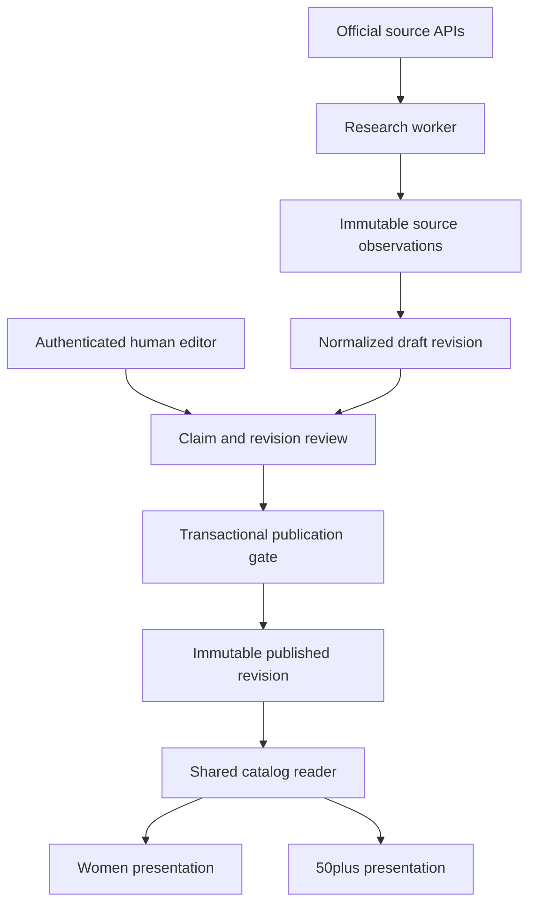

# Peppy Tides architecture

## One scientific record, two presentations

A relational application stores peptide identity separately from editorial revisions. Next.js renders a shared article model with women and 50plus theme profiles. Audience choice can change typography, spacing, navigation emphasis, and explanation depth. Claim text, evidence, safety, citations, regulatory facts, and review metadata are identical.

## Module ownership

| Module       | Owns                                                                                         | Public operations                                  |
| ------------ | -------------------------------------------------------------------------------------------- | -------------------------------------------------- |
| Database     | Identity, normalized evidence, citations, permissions, immutable revisions                   | Migrations and constrained transactions            |
| Catalog      | Published projections, alias and full-text search, taxonomy and comparisons                  | Read published article, search, browse             |
| Editorial    | Draft changes, human reviews, publication, revision history                                  | Create draft, save claim, review, publish, archive |
| Research     | Source adapters, source identity normalization, observations, jobs and extraction validation | Discover, fetch, extract draft, detect updates     |
| Auth         | Password verification, expiring sessions, role checks                                        | Sign in, sign out, require role                    |
| Presentation | Shared semantic UI and audience profiles                                                     | Render validated catalog model                     |

Prefer one application and one worker package over independent microservices. Scientific policies belong in database constraints and the editorial module. Framework route handlers validate untrusted inputs and invoke these operations.

## Data flow and interfaces

Researchers submit a canonical name, aliases, and optional identifiers. Adapters fetch official metadata with bounded retries, per-host throttles, response-size limits, timeouts, and explicit error states. A retry uses the same job key. Observations retain source URL, retrieval time, content hash, permissions, and locator. Extraction results are validated structured data that create drafts only.

The published catalog reads a publication pointer to a frozen revision. Updating a draft cannot change the public article. Search includes canonical names, aliases, targets, mechanisms, and taxonomy through Postgres full-text and trigram indexes. Search normalizes punctuation for names such as BPC157 and BPC-157. Comparison accepts two through four distinct published IDs and uses identical scientific fields.

## Concurrency and authorization

Revision state transitions use row locks. Publication verifies the editor identity in a database transaction, not a caller-supplied role. Immutable child-table triggers block changing published or approved content. Review and content writes lock the same parent revision to prevent approval races. Clone a revision to update it. Jobs claim work with `FOR UPDATE SKIP LOCKED`, bounded leases, retry counters, and stable deduplication keys.

Database application roles cannot bypass publication policy. Database owners remain operationally privileged and are not used for browser or research-worker requests. Public reads expose published rows only. Local development credentials are separate from production secrets.

## Deployment

Use PostgreSQL 17 with migrations. Local development uses Docker and a server environment file. Production can use managed PostgreSQL or Supabase with equivalent migrations and authentication integration. Next.js uses server rendering, metadata, canonical URLs, sitemap, robots, and structured data for published pages only. Draft preview is authenticated, marked noindex, and excluded from sitemap.

Production secrets, hosting, domain, mail, and a human editorial reviewer are external prerequisites. Missing prerequisites remain visible in project progress. Scientific publication cannot be completed by an agent acting as its own human reviewer.

## Design comparison

Candidate A uses relational revision ownership. Candidate B examines event sourcing. Compare provenance, publication isolation, authorization, operational simplicity, and queryability on a five-point scale. Record independent review and final synthesis in `design/synthesis.md` before application implementation.

## Implementation sequence

Establish source access, schema, evidence rubric, and five draft dossiers first. Execute migrations and policy checks locally. Then implement acquisition, editorial review, public catalog, discovery, audience profiles, and quality checks. The requirements authorize tests for evidence, search, publication, source normalization, authentication, and end-to-end behavior.
